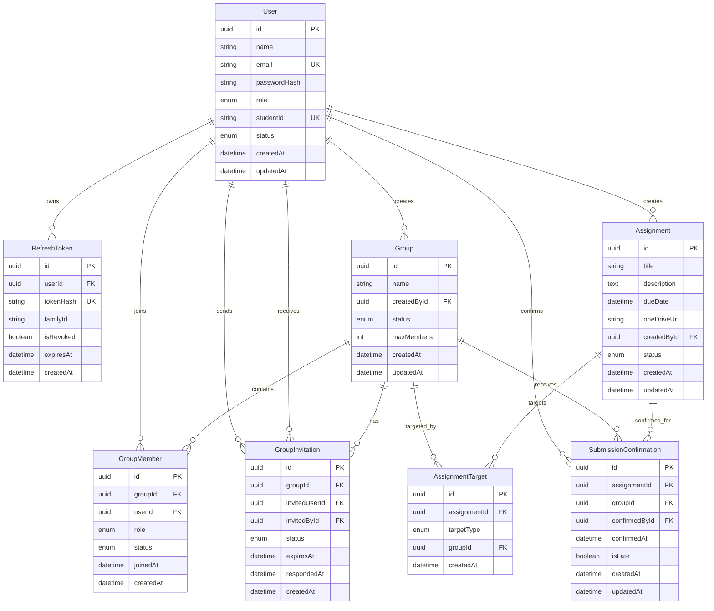

# Joineazy Database Schema & ERD — Sprint 1 & 2

## Complete Entity Relationship Diagram

## Relational Constraints & Invariants

1. **Unique Email**: `User(email)` is case-insensitively unique.
2. **Unique Student ID**: `User(studentId)` is unique when provided.
3. **Unique Group Membership**: `GroupMember(groupId, userId)` ensures no student is added twice to the same group.
4. **Single Active Group Rule**: Business service transactions enforce that a student cannot have more than one active membership simultaneously.
5. **Atomic Invitation Acceptance**: Invitation acceptance updates invitation status to `ACCEPTED` and inserts the `GroupMember` in an isolated database transaction, checking max group capacity (default 5).
6. **Audience Targeting Integrity**:
   - `ALL_STUDENTS`: `targetType = 'ALL_STUDENTS'` and `groupId = null`.
   - `SELECTED_GROUP`: `targetType = 'SELECTED_GROUP'` with valid active `groupId`.
7. **Unique Group Submission**: `SubmissionConfirmation(assignmentId, groupId)` is unique, enforcing that each group has exactly one confirmation record per assignment.
8. **Confirmation Auditability**: `confirmedById` records the exact student who verified the submission, with `isLate` preserved.
